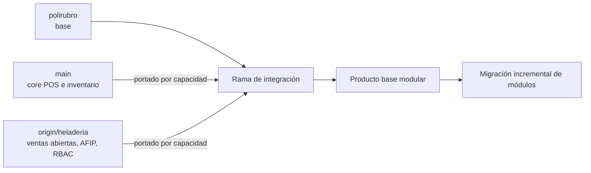

> Documento histórico de análisis. Para esta entrega rige la [ADR de MySQL compartida](14-ADR-MULTITENANT-COMPARTIDO.md); las propuestas de instancia dedicada y las validaciones externas de este texto no se consideran implementadas.

# Análisis de ramas y procedencia funcional

## Conclusión

La evolución debe comenzar en `polirubro` e incorporar capacidades concretas de `main` y `origin/heladeria` mediante portado selectivo. Una fusión total mezclaría modelos, interfaces y supuestos de autorización incompatibles, y aumentaría el riesgo de regresiones antes de consolidar un producto base actualizable.

## Hallazgos confirmados

### `polirubro`: base de integración

- Interfaz principal en Blade + Alpine.
- Flujos de escaneo para catálogo y ventas.
- Soporte de productos pesables y cantidades decimales.
- Descuentos por categoría.
- Configuración parcial del comercio.
- No existe ingreso de mercadería por scanner.
- React permanece de forma residual o duplicada y no debe considerarse la interfaz objetivo.

### `main`: núcleo operativo

Aporta la referencia funcional para:

- punto de venta;
- inventario y movimientos de stock;
- caja y movimientos;
- clientes y proveedores;
- cuentas corrientes, deudas, cheques y finanzas;
- ventas, ítems y medios de pago.

Estas capacidades deben compararse por caso de uso y esquema, no asumirse como compatibles línea por línea.

### `origin/heladeria`: capacidades especializadas

Aporta implementaciones o referencias para:

- ventas abiertas;
- agregado incremental de ítems y cierre;
- tickets;
- punto de caja;
- integración AFIP y configuración fiscal;
- RBAC;
- auditoría.

No aporta entidades de mesa ni comanda. “Ventas abiertas” debe modelarse como ciclo de vida de una venta, sin introducir conceptos gastronómicos inexistentes.

## Brechas transversales

| Área | Estado actual | Implicación |
|---|---|---|
| Multitenancy | Inexistente | No hay garantía de aislamiento de datos ni recursos |
| Autorización | Parcial y dependiente de rama | Debe consolidarse en roles de la instancia |
| Pruebas | No hay suite real | La migración necesita crear una red mínima antes de cambios de datos |
| Frontend | Blade + Alpine coexistiendo con React residual | Definir Blade + Alpine como canónico y retirar duplicados con evidencia |
| Ingreso por scanner | Inexistente | Es funcionalidad futura, no una migración disponible |
| Fiscal | Disponible como referencia en `origin/heladeria` | Debe desacoplarse por instancia cliente |

## Estrategia de integración

1. Congelar un inventario funcional por rama y sus dependencias.
2. Definir módulos, perfiles y puntos de extensión antes de portar capacidades.
3. Portar una capacidad por vez, con migraciones pequeñas y pruebas.
4. Consolidar autorización, caché, storage, jobs y auditoría para una instancia dedicada.
5. Eliminar duplicación sólo después de validar paridad.

## Reglas de procedencia

- No copiar controladores sin revisar consultas sin scope, validaciones y efectos secundarios.
- No copiar migraciones asumiendo que el orden histórico será válido.
- No propagar `role` global de usuario como autorización del comercio.
- No introducir acoplamientos que impidan desplegar y actualizar cada instancia por separado.
- Registrar en cada entrega: rama origen, archivos portados, adaptaciones y pruebas.

## Riesgos principales

1. **Divergencia entre clientes:** cambios directos que no pueden actualizarse desde el núcleo.
2. **Deriva funcional:** combinar flujos similares con reglas distintas.
3. **Falsa cobertura:** confundir compilación o pruebas manuales con aislamiento probado.
4. **Acoplamiento fiscal:** credenciales y numeración AFIP compartidas accidentalmente.
5. **Doble interfaz:** mantener React y Blade para el mismo caso de uso sin dueño claro.

## Criterio de salida del análisis

El análisis se considera suficiente cuando cada capacidad a migrar tiene rama fuente, dependencias, modelo afectado, estrategia de aislamiento, pruebas requeridas y decisión explícita de portar, reescribir o descartar.
