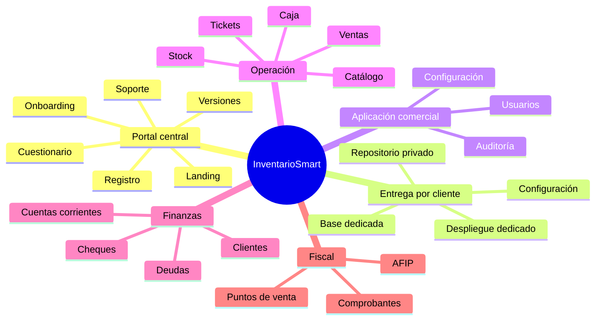

# Visión de producto

> **Estado vigente:** portal central de onboarding asistido más instancia y repositorio privado por cliente. Ver ADR 12.

## Propósito

Convertir InventarioSmart en un servicio de gestión comercial acompañado: el cliente explica su operación, el equipo recomienda la solución y entrega una instancia dedicada que integra venta, inventario, caja, finanzas y cumplimiento fiscal.

## Usuarios objetivo

- **Dueño/administrador del comercio:** responde el relevamiento, valida la propuesta y administra la operación entregada.
- **Cajero/vendedor:** busca o escanea productos, administra ventas abiertas, cobra, emite comprobantes y opera su punto de caja.
- **Responsable de stock:** administra catálogo, movimientos e ingresos de mercadería.
- **Responsable financiero:** controla cajas, cuentas corrientes, deudas, cheques y conciliaciones.
- **Contador o auditor:** consulta información fiscal y trazabilidad con acceso limitado.
- **Consultor de onboarding:** traduce necesidades del comercio a configuración, módulos y tareas.
- **Administrador de plataforma:** gestiona prospectos, clientes, entregas, versiones y soporte sin acceso operativo implícito.

## Propuesta de valor

1. Operación cotidiana integrada, sin duplicar ventas, stock y caja.
2. Configuración profesional por comercio, sin exigir decisiones técnicas al cliente.
3. Aislamiento mediante aplicación, base, storage, secretos y repositorio dedicados.
4. Trazabilidad de acciones sensibles.
5. Integración AFIP aislada por contribuyente y punto de venta.
6. Evolución modular desde un núcleo común, con extensiones controladas por cliente.

## Principios de producto

- **Aislamiento por instancia:** un despliegue operativo sirve a un solo comercio y no comparte datos transaccionales.
- **Acompañamiento primero:** el cliente describe problemas; el equipo decide la solución técnica con su aprobación.
- **Operación primero:** los flujos frecuentes minimizan pasos y toleran scanner/teclado.
- **Una interfaz canónica:** Blade + Alpine; no se amplía React residual.
- **Auditable:** cambios de permisos, caja, ventas, stock y fiscal dejan evidencia.
- **Fiscal desacoplado:** una indisponibilidad externa no corrompe el estado comercial.
- **Núcleo actualizable:** las mejoras comunes vuelven al producto base y pueden propagarse a los repositorios cliente.
- **Exclusividad excepcional:** una función vive sólo en un cliente cuando no puede resolverse como configuración o módulo reutilizable.

## Capacidades de la plataforma

## Experiencias clave

### Alta y acceso

El contacto se registra en el portal, verifica su email y completa un cuestionario básico. InventarioSmart revisa la información, realiza discovery, propone configuración y prepara la instancia. La activación ocurre después de demo, validación y capacitación.

### Venta

El operador crea una venta, agrega ítems por búsqueda o scanner, aplica reglas autorizadas, selecciona medios de pago, cierra y emite ticket. Una venta puede permanecer abierta, pero no implica mesa ni comanda.

### Inventario

El catálogo admite productos estándar y pesables, categorías y descuentos. Los movimientos de stock son trazables. El ingreso de mercadería por scanner se diseña como capacidad nueva y no se declara disponible.

### Fiscal

El comercio configura condición, credenciales y puntos de venta. La autorización del comprobante se procesa con idempotencia, trazabilidad y secretos segregados.

## Fuera de visión inmediata

- Provisioning operativo completamente automático.
- Base de datos transaccional compartida entre clientes.
- Selector de tenant dentro de la aplicación entregada.
- Entidades de mesa, salón o comanda.
- Reescritura total del frontend.
- Marketplace o arquitectura de microservicios.
- Facturación SaaS avanzada antes de consolidar el aislamiento.

## Indicadores de éxito

- Cero infraestructura o datos operativos compartidos accidentalmente entre clientes.
- Tiempo medible desde cuestionario completo hasta propuesta y entrega.
- Cada instancia registra versión del núcleo, módulos y overrides.
- Todas las credenciales y numeraciones AFIP pertenecen a una única instancia.
- Tiempo y errores de los flujos POS no empeoran respecto de la base.
- Las actualizaciones del núcleo se prueban por perfil antes de desplegar en cada cliente.
- Disminuye la proporción de cambios exclusivos frente a capacidades reutilizables.
