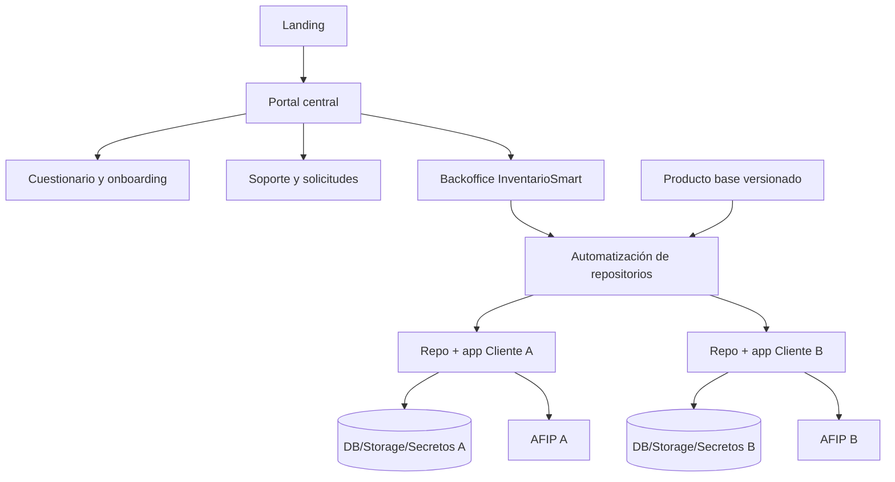

# Arquitectura objetivo

> **Vigente con ADR 12 actualizada.** El producto operativo es multi-tenant (MySQL compartida + `tenant_id`). El portal captura clientes y el equipo configura cada tenant. El repositorio privado es para features exclusivas, no para una app distinta.

## Vista general

La solución tiene dos productos con fronteras estrictas:

El portal conserva datos comerciales mínimos, respuestas del cuestionario, estado, contactos, soporte y metadatos de entrega. No consulta bases operativas. Cada aplicación cliente es single-tenant y se actualiza desde releases del producto base.

## Componentes vigentes

- **Portal:** Laravel + Blade/Alpine para captación, onboarding, backoffice y soporte.
- **Producto base:** aplicación comercial canónica, modular y versionada.
- **Generador de clientes:** crea repositorio, manifiesto, CI y ambientes desde una release.
- **Instancia cliente:** aplicación, MySQL, storage, colas, backups y secretos dedicados.
- **Registro de versiones:** relación entre cliente, release de núcleo, módulos, overrides y despliegues.
- **Canal de actualizaciones:** abre y valida upgrades del producto base en cada repositorio.

## Aislamiento vigente

La barrera primaria es la infraestructura dedicada. La aplicación cliente no recibe un `tenant_id` desde el request ni permite seleccionar otro comercio. Los identificadores de cuenta del portal nunca autorizan acceso a una base operativa.

## Antecedente descartado: aplicación multitenant compartida

### Resolución del tenant

La primera versión puede resolver el tenant desde ruta o subdominio y confirmar la membresía autenticada. El identificador recibido nunca es autorización suficiente.

Orden esperado:

1. autenticar usuario global;
2. resolver tenant solicitado;
3. comprobar tenant activo y membresía vigente;
4. inicializar `TenantContext`;
5. ejecutar autorización y lógica de negocio;
6. limpiar el contexto al finalizar.

En procesos persistentes —workers, Octane o tests— la limpieza es obligatoria para evitar contaminación entre ejecuciones.

### `TenantContext`

Servicio propio, registrado con ciclo de vida acotado, que expone el tenant activo y falla de forma cerrada cuando una operación tenant-aware se ejecuta sin contexto. No debe depender de variables globales estáticas sin mecanismo de limpieza.

### `TenantScope`

Global scope propio aplicado mediante un trait a modelos operativos. Agrega `where tenant_id = contexto` y asigna `tenant_id` al crear. Quitar el scope requiere una API explícita, reservada al plano de plataforma y servicios administrativos auditados.

El scope reduce omisiones, pero no reemplaza:

- claves foráneas e índices;
- validación de pertenencia de relaciones;
- policies;
- pruebas de aislamiento;
- protección de consultas raw, joins, agregados y subconsultas.

### Capas de aplicación

- **HTTP/UI:** rutas, middleware, formularios Blade y componentes Alpine.
- **Aplicación:** acciones o servicios por caso de uso; transacciones.
- **Dominio:** reglas de venta, stock, caja, finanzas y fiscal.
- **Infraestructura:** Eloquent, cache, storage, queue y proveedor AFIP.

Los controladores deben orquestar, no contener consultas extensas ni llamadas fiscales directas.

## Antecedente: aislamiento lógico de infraestructura compartida

| Recurso | Estrategia |
|---|---|
| MySQL | `tenant_id` obligatorio, índices compuestos, scope y constraints |
| Cache | prefijo `tenant:{id}:`; tags sólo si el driver las soporta |
| Storage | raíz `tenants/{id}/...`; nombres no derivados de input sin normalizar |
| Jobs | `tenant_id` explícito en payload; restaurar, validar y limpiar contexto |
| Scheduler | iterar tenants activos con ejecución aislada e idempotente |
| Logs | `tenant_id`, usuario y correlation ID como contexto; nunca secretos |
| Auditoría | eventos append-only con actor, tenant, acción y cambios seguros |
| AFIP | credenciales, punto de venta, secuencia e idempotencia por tenant |

## Antecedente: fronteras de seguridad compartidas

El plano de tenant no puede consultar otros tenants, incluso con IDs conocidos. El plano de superadministración usa rutas, middleware, guards/policies y servicios separados. El soporte con impersonación, si se incorpora, requerirá motivo, vencimiento, banner visible y auditoría; no forma parte de la fundación inicial.

## Observabilidad

Toda solicitud y job debe incluir `tenant_id`, `user_id` cuando corresponda, request/job ID y operación. Métricas mínimas: errores por módulo, latencia, jobs fallidos, rechazos AFIP e intentos de acceso cruzado.

## Antecedente: despliegue y compatibilidad multitenant

- Migraciones de esquema compatibles hacia adelante y atrás durante el despliegue.
- Backfills reanudables y medidos.
- Features flags por tenant para módulos en transición.
- No eliminar columnas o rutas legacy hasta completar validación y rollback window.
- MySQL sigue siendo el único origen de verdad transaccional.

## Decisiones de la alternativa descartada

- base dedicada por tenant;
- microservicios;
- event sourcing;
- autorización dependiente exclusivamente de paquetes externos;
- incorporación amplia de React.
