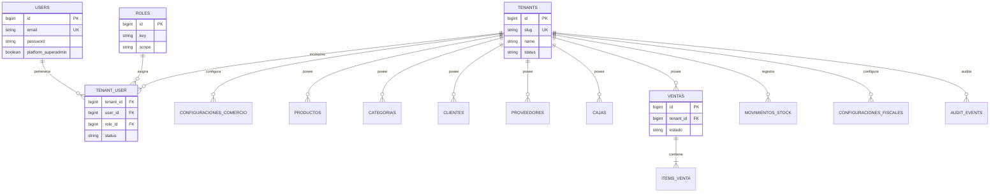

# Modelo de datos multitenant

> **Alternativa histórica descartada para la aplicación operativa.** La ADR 12 define bases separadas y una instancia single-tenant por cliente.

## Modelo conceptual

Los usuarios son identidades globales. Un usuario puede pertenecer a varios tenants y tener un rol distinto en cada uno. Las entidades operativas pertenecen exactamente a un tenant.

El diagrama muestra el objetivo, no el esquema ya implementado.

## Tablas de plataforma

### `tenants`

Campos mínimos previstos: `id`, `name`, `slug`, `status`, zona horaria, timestamps. El estado permite bloquear operación sin eliminar datos. El slug es identificador de routing, no reemplaza la clave primaria.

### `tenant_user`

Pivot con `tenant_id`, `user_id`, `role_id` o clave de rol, estado, timestamps e información opcional de invitación. Restricción única `(tenant_id, user_id)`. Nunca se debe inferir un rol del comercio desde `users.role`.

### Roles y permisos

Puede iniciarse con roles definidos por código y una asignación por membresía. Si se persisten roles, las claves deben tener unicidad coherente con su alcance. Los permisos efectivos se resuelven para el tenant activo.

### Superadministrador

La capacidad de plataforma queda separada de `tenant_user`. No concede acceso operativo silencioso a todos los comercios. Las herramientas de plataforma usan rutas y servicios dedicados.

## Tablas de negocio

Cada agregado tenant-aware deberá incorporar:

- `tenant_id` no nulo;
- FK a `tenants`;
- índice comenzando por `tenant_id` para consultas frecuentes;
- unicidad compuesta cuando la regla sea local al comercio;
- relaciones que impidan asociar objetos de tenants distintos.

Ejemplos:

| Regla | Restricción objetivo |
|---|---|
| Código/SKU único por comercio | `unique(tenant_id, codigo)` |
| Nombre de caja único por comercio | `unique(tenant_id, nombre)` si aplica |
| Punto de venta AFIP único por comercio | `unique(tenant_id, numero)` |
| Una membresía por usuario y comercio | `unique(tenant_id, user_id)` |
| Búsqueda de ventas por fecha | `index(tenant_id, created_at)` |

## Integridad entre relaciones

El scope no impide por sí solo asignar a una venta un cliente de otro tenant. Los servicios deben cargar relacionados bajo el mismo contexto y validar pertenencia. Para relaciones críticas se evaluarán claves compuestas `(tenant_id, id)` y FKs compuestas, considerando las limitaciones de Eloquent y el costo operacional.

## Identificadores y exposición

Los IDs incrementales pueden mantenerse internamente si toda resolución está scoped. Para URLs públicas o tickets consultables puede agregarse UUID/ULID opaco; esto mejora exposición, pero no sustituye autorización.

## Ciclo de migración por tabla

1. Inventariar consultas, relaciones y reglas únicas.
2. Agregar `tenant_id` nullable e índice.
3. Backfill por lotes con una regla de mapeo verificable.
4. Adaptar escrituras para poblar tenant.
5. Activar scope y pruebas.
6. Validar nulos, huérfanos y cruces.
7. Convertir a `NOT NULL`, agregar FK y unicidades compuestas.
8. Retirar compatibilidad legacy cuando termine la ventana de rollback.

## Datos sensibles y retención

Credenciales AFIP se cifran en reposo y nunca aparecen en auditoría. Adjuntos y tickets respetan prefijos de storage por tenant. Borrado de tenant será un proceso administrativo con retención fiscal y backup definidos; no un `DELETE` en cascada inmediato.

## Alcance actual

Esta fundación **no ejecuta este modelo sobre las tablas de negocio**. En particular, no agrega todavía `tenant_id`, no realiza backfill y no cambia constraints existentes.
