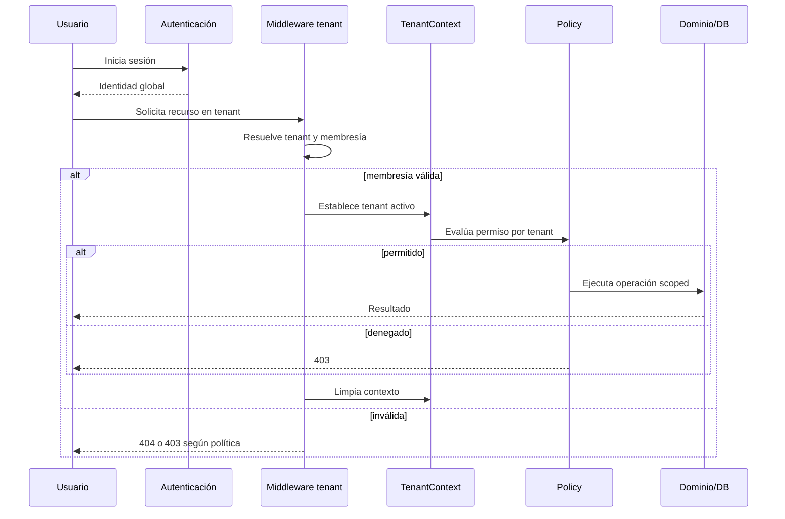

# Autorización y aislamiento

> **Alternativa histórica.** El producto vigente aísla clientes por repositorio, aplicación, base, storage y secretos dedicados; no mediante selección de tenant en la aplicación operativa.

## Objetivo

Garantizar que una identidad global sólo opere sobre un tenant en el que tiene membresía activa y únicamente con los permisos de su rol en ese tenant. El aislamiento debe cubrir datos, procesos y recursos, no sólo navegación.

## Flujo de autorización

## Modelo RBAC inicial

Roles orientativos:

- **owner:** control total del tenant, incluida administración de membresías.
- **admin:** configuración y operación amplia, sin transferir propiedad.
- **cashier:** ventas, tickets y caja asignada.
- **stock_manager:** catálogo, proveedores y stock.
- **finance:** caja, cuentas corrientes, deudas y cheques.
- **auditor:** lectura y auditoría, sin mutaciones operativas.

La matriz final se expresa como permisos atómicos (`sales.open`, `sales.close`, `stock.adjust`, `cash.close`, `fiscal.issue`, `members.manage`) y no como condicionales dispersos por nombre de rol.

## Capas de defensa

1. **Middleware:** autentica, resuelve tenant y comprueba membresía.
2. **`TenantContext`:** representa un único tenant activo y falla cerrado sin contexto.
3. **`TenantScope`:** limita modelos tenant-aware.
4. **Policies/gates:** autorizan acciones sobre recursos ya aislados.
5. **Servicios de dominio:** validan invariantes y pertenencia de relaciones.
6. **Base de datos:** FKs, índices, no nulos y unicidades compuestas.
7. **Pruebas:** intentos explícitos de acceso cruzado.

Ninguna capa individual es suficiente.

## Estado transitorio de la fundación

El login Blade heredado todavía muestra un selector global de usuarios y las rutas operativas aún no ejecutan el middleware `tenant`, porque sus tablas no tienen `tenant_id`. Esto sólo es admisible con `TENANCY_LEGACY_MODE=true` durante la migración. Antes de habilitar múltiples comercios reales se debe reemplazar el selector global por autenticación de identidad, aplicar el middleware junto con la migración completa del primer módulo y demostrar aislamiento endpoint por endpoint.

## Reglas obligatorias

- No aceptar `tenant_id` del formulario como fuente de autorización.
- No usar `find()` sin scope para recursos operativos.
- No permitir mass assignment de `tenant_id`.
- No ejecutar `withoutGlobalScopes()` en controladores.
- No confiar en ocultar botones: el backend siempre reautoriza.
- No serializar modelos de un tenant en un job sin incluir y validar el tenant.
- No reutilizar caché o archivos sin namespace.
- No registrar secretos fiscales, tokens, contraseñas ni datos de tarjeta.

## Superadministración

El superadmin es una capacidad del plano SaaS, no un rol de tenant. Sus rutas tienen middleware propio. El acceso a datos operativos debe ser explícito, mínimo y auditado. No se crea una membresía automática en todos los tenants.

## Jobs y tareas programadas

Todo job tenant-aware incluye `tenant_id` inmutable. El worker:

1. obtiene el tenant activo y valida su estado;
2. establece contexto;
3. ejecuta idempotentemente;
4. registra resultado con correlation ID;
5. limpia contexto en `finally`.

Los jobs sin tenant sólo se admiten para tareas reales de plataforma. El scheduler itera tenants y despacha unidades separadas para limitar fallas.

## Caché y storage

- Claves: `tenant:{tenant_id}:{dominio}:{clave}`.
- Invalidación: siempre dentro del mismo namespace.
- Archivos: `tenants/{tenant_id}/{modulo}/{archivo}`.
- URLs firmadas: corta duración y autorización previa.
- Importaciones: staging privado por tenant y validación antes de promover.

## Auditoría

Eventos mínimos: cambio de membresías/roles, apertura y cierre de caja, anulación/cierre de venta, ajuste de stock, cambios fiscales, emisión/reintento de comprobantes y accesos administrativos. Cada evento incluye tenant, actor, acción, objeto, fecha, correlation ID y diferencias saneadas.

## Pruebas de aceptación de aislamiento

- Un usuario de A no puede listar, leer, modificar ni borrar recursos de B.
- Un usuario miembro de A y B obtiene resultados distintos al cambiar contexto.
- IDs manipulados no atraviesan tenant.
- Relaciones cruzadas son rechazadas.
- Cache, storage y jobs de A no se observan en B.
- Un worker no conserva el tenant del job anterior.
- El superadmin no ingresa a operación por rutas normales.
- Las consultas raw relevantes incluyen condición de tenant o una abstracción segura.
