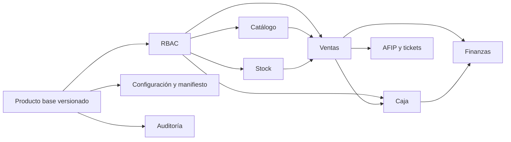

# Catálogo y matriz de módulos

## Criterio

`polirubro` es el **producto base**: POS de mostrador de alto volumen (almacén, farmacia, retail). Las otras ramas no se fusionan: se convierten en **módulos enchufables**. Lo que no cubre un módulo se desarrolla a medida.

| Módulo | Procedencia | Estado | A quién se ofrece |
|---|---|---|---|
| POS de mostrador (`core.pos`) | `polirubro` | Listo | Farmacia, almacén, polirubro |
| Scanner (`catalog.scanner`) | `polirubro` | Listo | Mostradores de alta demanda |
| Ventas abiertas (`sales.open_orders`) | `origin/heladeria` | Listo | Heladería, bar, restaurant |
| Mesas y comandas (`sales.tables`) | Heladería (a portar) | **Próximamente** | Bar y restaurant |
| Turnos (`services.appointments`) | Nuevo | Listo | Dentista, consultorio, estética |
| Catálogo / stock / caja | Base | Listo | Todos |
| Finanzas y AFIP | `main` / heladería | Listo | Según el comercio |

Un bar recibe ventas abiertas (y mesas cuando exista). Una farmacia recibe el POS pulido de polirubro. Un dentista recibe turnos. Si el flujo no entra, se clasifica como desarrollo a medida.

| Módulo | Base/procedencia confirmada | Estado o brecha | Objetivo |
|---|---|---|---|
| Autenticación | Base actual | Flujo legacy | Login y roles locales de la instancia |
| Portal de clientes | Nuevo | Inexistente | Registro, cuestionario, onboarding y soporte |
| Backoffice | Nuevo | Inexistente | Revisión, entregas, versiones y soporte |
| Configuración comercio | `polirubro` | Parcial | Perfil y manifiesto de la instancia |
| Usuarios/RBAC | `origin/heladeria` como referencia | Roles a consolidar | Permisos atómicos dentro del comercio |
| Auditoría | `origin/heladeria` como referencia | No transversal | Eventos saneados en la instancia |
| Categorías | `polirubro` / core | Incluye descuento por categoría | Conservar y aislar |
| Productos | `polirubro` / `main` | Escaneo y productos pesables | Consolidar catálogo configurable |
| Proveedores | `main` / base | Core disponible | Integrar con stock |
| Stock | `main` / base | Movimientos disponibles | Trazabilidad y permisos |
| Ingreso por scanner | Nuevo | **No existe** | Diseñar después del core de stock |
| Clientes | `main` / base | Core disponible | Vincular a ventas/finanzas |
| Ventas POS | `polirubro` | Producto base | Mostrador de alto volumen; venta cerrada al cobrar |
| Ventas abiertas | `origin/heladeria` | Módulo listo | Heladería, bar y restaurant |
| Mesa/comanda | Heladería (a portar) | Módulo `sales.tables`, no listo | Se ofrece encima de ventas abiertas |
| Tickets | `origin/heladeria` | Disponible como referencia | Plantilla por perfil/cliente |
| Cajas/punto de caja | `main` + `origin/heladeria` | Variantes funcionales | Unificar apertura, movimientos y cierre |
| Cuentas corrientes | `main` | Core disponible | Autorizar y auditar |
| Deudas y cuotas | `main` | Core disponible | Integrar con pagos |
| Cheques | `main` | Core disponible | Autorizar y auditar |
| AFIP/fiscal | `origin/heladeria` | Requiere desacople | Adaptador y credenciales por instancia |
| Frontend Blade + Alpine | `polirubro` | Canónico | Continuar |
| React | Residual/duplicado | Sin rol objetivo | No ampliar; retirar tras paridad |
| Tests | Ninguna rama con suite real | Cobertura insuficiente | Crear desde la fundación |

## Dependencias funcionales

## Prioridad

### Base obligatoria

Producto base versionado, perfiles, manifiesto, autorización, auditoría, pruebas y automatización de actualización. Ningún cliente nuevo debe depender de copiar cambios manualmente.

### Operación esencial

Configuración, catálogo, productos pesables, ventas, ventas abiertas, tickets, caja y stock. Deben preservar velocidad de uso y scanner existente.

### Administración financiera y fiscal

Clientes, proveedores, cuentas corrientes, deudas, cheques y AFIP. Se migran después de estabilizar las transacciones que los alimentan.

### Evolución

Ingreso de mercadería por scanner, módulo de turnos, mesas/comandas y reportes avanzados. Cada uno entra al catálogo antes de desarrollarse; no se copia una rama completa.

## Definición de módulo entregable

Un módulo puede habilitarse en una instancia cliente cuando:

- tiene límites, configuración y dependencias explícitos;
- consultas, validaciones y relaciones son consistentes;
- sus permisos están definidos y probados;
- cache, archivos y jobs funcionan dentro de la instancia dedicada;
- tiene auditoría para acciones sensibles;
- cuenta con pruebas de caso feliz, autorización y regresión por perfil;
- puede actualizarse desde el producto base sin editar manualmente cada cliente;
- existe estrategia de despliegue y rollback.
