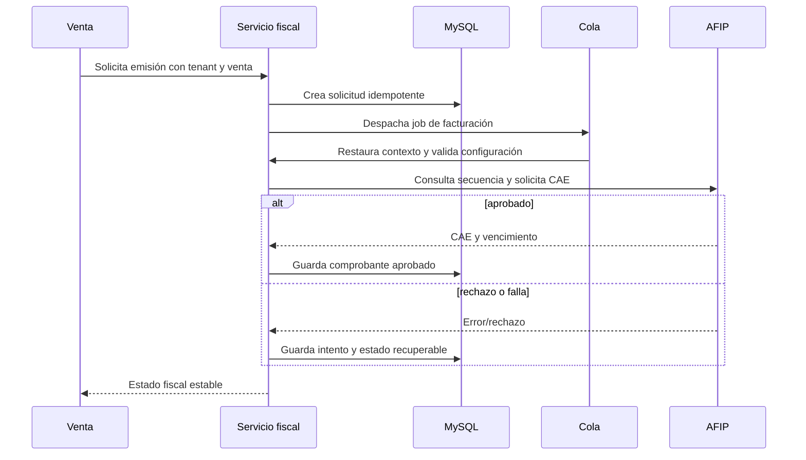

# Arquitectura fiscal y AFIP

## Objetivo

Incorporar las capacidades fiscales de `origin/heladeria` como referencia funcional, desacoplándolas del flujo de venta. Cada cliente conserva configuración, credenciales, numeración, caché, archivos, jobs y auditoría en su instancia dedicada.

## Límites del módulo

El dominio de ventas determina importes, ítems, impuestos y receptor. El módulo fiscal transforma esa operación en una solicitud AFIP, persiste intentos y respuestas, y devuelve un resultado estable. No debe recalcular silenciosamente la venta ni depender de estado global.

## Datos por instancia cliente

- CUIT y condición fiscal.
- Razón social, domicilio y datos de impresión.
- Ambiente homologación/producción.
- Certificado, clave privada y vigencia, cifrados en reposo.
- Puntos de venta habilitados.
- Tipos de comprobante permitidos.
- Secuencias y último número confirmado por punto de venta/tipo.
- Preferencias de ticket.

Nunca se comparten credenciales ni numeración entre tenants.

## Flujo de emisión

## Estados sugeridos

`pending`, `processing`, `approved`, `rejected`, `retryable_error`, `manual_review`. Una venta cerrada y su estado fiscal son conceptos relacionados pero distintos. Un timeout no debe marcar automáticamente rechazo ni disparar una numeración nueva.

## Idempotencia y concurrencia

- Clave idempotente por `(venta_id, tipo_comprobante)` dentro de la base dedicada.
- Un solo procesamiento activo por comprobante.
- Bloqueo/transacción al reservar o confirmar numeración.
- Antes de reintentar tras timeout, consultar estado o último número en AFIP.
- Persistir request fingerprint y resultado, sin secretos.
- Reintentos con backoff sólo para errores clasificados como transitorios.

## Seguridad

- Secretos cifrados con rotación planificada.
- Acceso limitado a permisos de configuración fiscal.
- No exponer clave privada, tokens ni payloads sensibles en logs.
- Descargas de comprobantes autorizadas y bajo storage `tenants/{id}/fiscal`.
- Cambios de CUIT, ambiente, certificado y punto de venta auditados.
- Separación visible y técnica entre homologación y producción.

## Adaptador

La aplicación consume una interfaz fiscal interna, no el cliente AFIP directamente. Esto permite:

- reemplazar librería/proveedor;
- simular respuestas en tests;
- clasificar errores de forma uniforme;
- incorporar homologación sin condicionales dispersos;
- proteger el dominio ante cambios externos.

## Operación y observabilidad

Métricas por instancia y punto de venta: emisiones, aprobaciones, rechazos, latencia, reintentos, vencimiento próximo de certificados y jobs fallidos. Las alertas deben evitar datos fiscales sensibles.

Debe existir una bandeja de revisión para comprobantes no resueltos, con acciones autorizadas, historial y correlación con venta e intentos.

## Pruebas mínimas

- Configuración fiscal de A no es visible ni utilizable por B.
- Numeración independiente por instancia, punto de venta y tipo.
- Un reintento no duplica comprobantes.
- Timeout seguido de confirmación recupera el resultado correcto.
- Certificado vencido produce error controlado.
- Worker restaura y limpia contexto.
- Homologación no utiliza credenciales ni endpoints de producción.
- Los errores y auditorías no contienen secretos.

## Alcance de la fundación

Esta etapa documenta contratos y límites. No porta de forma completa AFIP desde `origin/heladeria`, no activa emisión productiva y no migra configuraciones fiscales existentes.
