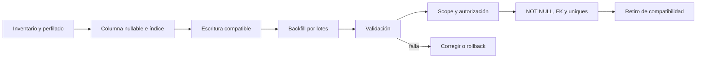

# Playbook de migración legacy

> **Requiere reinterpretación por cliente.** Los datos legacy se migran hacia la base dedicada de una única instancia; no se reparten en una base compartida mediante `tenant_id`.

## Objetivo

Migrar capacidades y datos de manera incremental, verificable y reversible. La estrategia evita fusionar ramas completas y evita agregar `tenant_id` masivamente antes de contar con contexto, scopes y pruebas.

## Preparación

1. Identificar dueño funcional y rama fuente de cada capacidad.
2. Inventariar tablas, relaciones, consultas raw, caches, archivos, jobs y permisos.
3. Crear pruebas de caracterización del comportamiento que se conservará.
4. Definir tenant destino y regla de mapeo para cada registro legacy.
5. Medir volumen, nulos, duplicados y huérfanos.
6. Definir rollback y ventana de compatibilidad.

## Portado de código por capacidad

Para cada módulo:

1. Comparar casos de uso, no sólo archivos.
2. Seleccionar implementación fuente.
3. Extraer dependencias mínimas.
4. Adaptar a Blade + Alpine y servicios objetivo.
5. Incorporar autorización por tenant.
6. Aislar cache, storage y jobs.
7. Agregar pruebas antes de activar.
8. Habilitar por feature flag o lote controlado.

No se amplía React residual. Sólo se elimina cuando la vista Blade + Alpine equivalente está validada.

## Migración de esquema y datos

### Expandir

- Agregar estructuras nuevas sin romper la versión desplegada.
- `tenant_id` comienza nullable cuando existen datos.
- Introducir escrituras duales o compatibles sólo cuando sean necesarias y temporales.
- Crear índices con estrategia acorde al tamaño y disponibilidad.

### Backfill

- Ejecutar por clave primaria y lotes reanudables.
- Registrar checkpoint, conteos y errores.
- Asignar tenant mediante una regla determinista; nunca usar un tenant por defecto si hay ambigüedad.
- Pausar ante registros sin mapeo y enviarlos a remediación.

### Validar

- Conteos totales y por tenant.
- Cero `tenant_id` nulos en el conjunto migrado.
- Cero relaciones cruzadas.
- Totales financieros y de stock reconciliados.
- Unicidades locales detectadas antes de crear constraints.
- Muestreo funcional y pruebas automáticas.

### Contraer

Sólo después de operar establemente: `NOT NULL`, FKs, unicidades compuestas, retiro de rutas/columnas legacy y eliminación de código temporal.

## Orden recomendado de datos

1. tenants y configuración;
2. usuarios, membresías, roles;
3. categorías y productos;
4. clientes y proveedores;
5. cajas;
6. ventas e ítems;
7. stock;
8. cuentas corrientes, deudas y cheques;
9. configuración y comprobantes fiscales;
10. auditoría y adjuntos.

El orden final se ajusta según FKs reales y dependencias verificadas.

## Despliegue

- Backup probado antes de backfills irreversibles.
- Migraciones pequeñas y observables.
- Feature flag por módulo/tenant.
- Piloto con datos representativos.
- Métricas y logs con correlation ID.
- Congelar cambios incompatibles durante cortes de datos.
- Documentar quién decide continuar o revertir.

## Rollback

El rollback debe distinguir código, esquema y datos. Volver código no revierte automáticamente un backfill. Mientras exista ventana de rollback, conservar estructuras compatibles y no borrar origen. Las operaciones externas —especialmente AFIP— no se “deshacen”; se compensan según reglas fiscales.

## Checklist por módulo

- [ ] Fuente y comportamiento objetivo documentados.
- [ ] Dependencias inventariadas.
- [ ] Mapping de tenant sin ambigüedades.
- [ ] Migraciones expand/contract revisadas.
- [ ] Backfill reanudable.
- [ ] Pruebas de caracterización, autorización y aislamiento.
- [ ] Cache/storage/jobs aislados.
- [ ] Reconciliación definida.
- [ ] Feature flag y observabilidad.
- [ ] Rollback ensayado.
- [ ] Aprobación funcional y técnica.

## Casos que requieren diseño nuevo

El ingreso de mercadería por scanner no existe y no debe aparecer como “migrado”. Mesa/comanda tampoco existe en las fuentes confirmadas. Cualquier incorporación futura debe pasar por definición de producto, modelo y criterios de aceptación propios.
