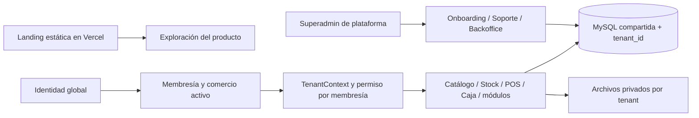

# ADR: producto operativo multitenant con MySQL compartida

- Estado: vigente para esta entrega.
- Fecha: 12/10/2026.
- Alcance confirmado: Mauro pidió completar el tenant, integrar las tareas ISM en una rama y mantener Jira actualizado.
- Reemplaza la decisión de instancias dedicadas de agosto, conservada en [historia](history/2026-08-23/12-ADR-INSTANCE-PER-CLIENT.md).

## Decisión y motivo

InventarioSmart opera varios comercios en una aplicación Laravel y una base MySQL compartida. Cada entidad de negocio tiene `tenant_id`; las identidades son globales y las membresías asignan rol y estado por comercio. Esta es la arquitectura implementada que se endurece en ISM-1, no un provisioning de repositorios, bases o infraestructura por cliente.

El portal de registro, onboarding asistido, soporte y backoffice comparte el despliegue de Laravel, con rutas y permisos de plataforma separados. La landing pública se exporta a Vercel y no publica el inventario ni datos del portal.

## Invariantes

- Ninguna membresía activa implica ningún acceso operativo. El rol global y ser superadmin no conceden acceso a un comercio.
- Resolver el tenant antes de route binding y autorización; limpiar el contexto después de cada request/job, también al fallar.
- Toda referencia de negocio pertenece al mismo tenant. Un operador referenciado debe ser miembro activo de ese comercio.
- Scopes fallan cerrados sin contexto; el bypass se reserva a operaciones explícitas de plataforma y migraciones.
- Códigos de producto y números de venta tienen unicidad local; archivos, cache, credenciales fiscales y ejecución asíncrona requieren namespaces de tenant.
- Un módulo habilitado no concede permisos. La base catálogo/stock/POS/caja siempre se conserva; módulos opcionales sólo si están disponibles.
- Blueprint de producto y metadatos de entrega no contienen secretos ni datos comerciales. No se generan repositorios ni infraestructura cliente como efecto de onboarding.

## Límites y consecuencias

El aislamiento lógico requiere cobertura transversal y revisión de consultas raw. Un backup físico de MySQL restaura la base completa: no se promete restauración independiente de un tenant sobre la base activa. Un entorno dedicado futuro necesitaría otra ADR, presupuesto y autorización de despliegue.

La existencia de código o `is_ready` en el catálogo no certifica validación de un servicio externo. ARCA/AFIP sigue sin entorno de homologación según Mauro; su emisión real y los escenarios de timeout necesitan esa validación antes de habilitar fiscalidad real. El backend permanece local; sólo la landing fue publicada.

## Estado y puertas de entrega

[Roadmap](08-DEVELOPMENT-ROADMAP.md), [modelo real](03-DATA-MODEL.md), [permisos](04-AUTHORIZATION-AND-ISOLATION.md) y [catálogo](05-MODULE-CATALOG.md) son la referencia vigente. Un ticket se cierra con pruebas y trazabilidad, sin equiparar implementación local con despliegue productivo o homologación.
